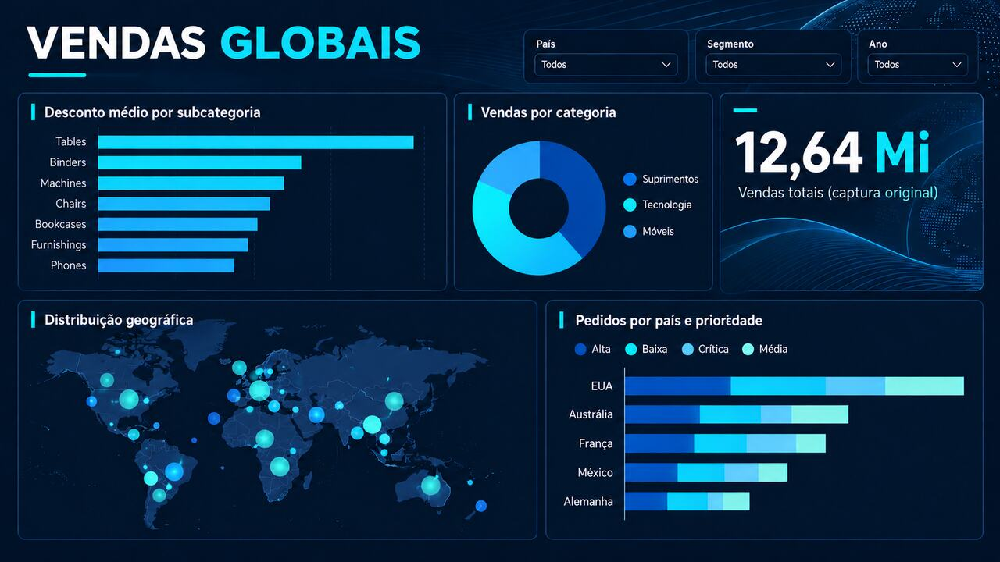
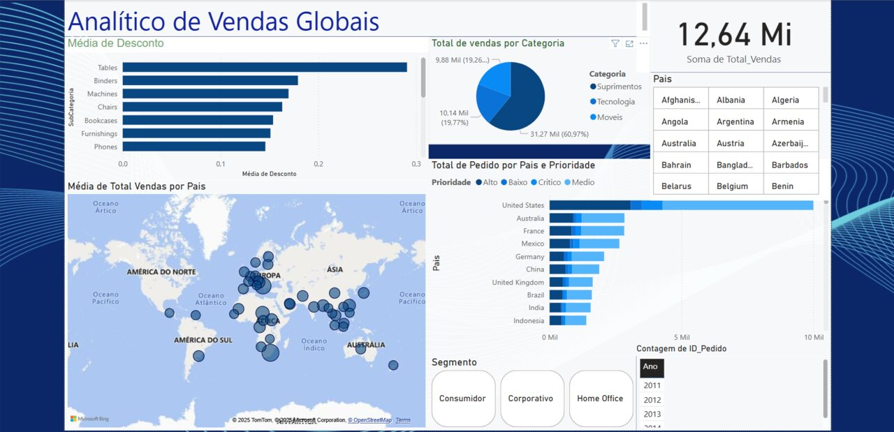

# Analítico de Vendas Globais | Power BI

**Business Intelligence · Exploração de indicadores · Visualização de dados**

Este projeto apresenta um relatório interativo desenvolvido no Power BI para explorar indicadores comerciais de vendas globais. A proposta é transformar diferentes visões do negócio em perguntas objetivas sobre categorias, descontos, distribuição geográfica e prioridades de pedidos.

> **Sobre a imagem:** a arte acima é um *redesign visual ilustrativo* criado para apresentação do portfólio. **Não é uma captura do arquivo `.pbix` e não representa uma nova execução ou validação dos dados.** A captura do painel original está disponível abaixo.

## Perguntas que o painel ajuda a investigar

| Frente de análise | Pergunta de negócio | Recurso exibido |
| --- | --- | --- |
| Vendas | Qual o volume agregado no contexto selecionado? | Indicador de total de vendas |
| Portfólio | Como as vendas se distribuem entre categorias? | Gráfico por categoria |
| Descontos | Onde os descontos médios são maiores? | Gráfico por subcategoria |
| Geografia | Como o desempenho varia entre países? | Visão geográfica |
| Operação | Como os pedidos se distribuem por país e prioridade? | Gráfico de pedidos por prioridade |
| Contexto | Como a conclusão muda ao alterar o recorte? | Filtros por país, segmento e ano |

## Painel original

O conteúdo acima é uma **imagem estática**. Para testar as interações, abra o arquivo Power BI:

**[Baixar o arquivo `.pbix`](./Analitico%20de%20vendas%20Globais.pbix)**

1. Instale o **Power BI Desktop**.
2. Baixe o `.pbix` e abra-o no Power BI Desktop.
3. Explore os filtros por país, segmento e ano.
4. Compare as categorias, as subcategorias e as prioridades de pedidos.

## Como interpretar com responsabilidade

- Antes de comparar indicadores, valide o **recorte dos filtros**.
- Desconto médio e volume de vendas não significam, isoladamente, rentabilidade.
- A imagem original mostra uma seleção específica; valores visíveis nela **não devem ser interpretados como números atuais**.
- Esta documentação descreve apenas o que é observável no projeto disponível; não atribui ao `.pbix` uma implementação de SQL, DAX avançado, ETL automatizado ou arquitetura de dados sem evidência pública.

## Sobre o desenvolvimento

- **Ferramenta principal:** Microsoft Power BI.
- **Entregável executável:** `Analitico de vendas Globais.pbix`.
- **Material de apresentação:** captura original e arte conceitual de redesign, claramente diferenciadas.
- **Objetivo do portfólio:** demonstrar raciocínio de negócio, interpretação de métricas e apresentação de informações.

## Autor

**Douglas Paiva**  
Business Intelligence & Data Analytics  
SAS Viya · SQL · Power BI · Python · Automação  
[LinkedIn](https://www.linkedin.com/in/dougllaspaiva/)

